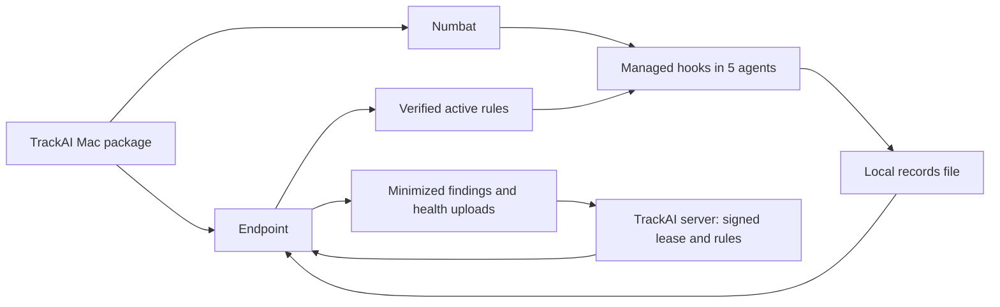

# Task20h-a: what the Mac package does, and how to check it

**Audience:** the founder running the first real Mac check. **Status:** the Intel Mac debug-package run finished on 2026-10-20; its results and remaining gaps are in [IT_T20H01_EVIDENCE.md](IT_T20H01_EVIDENCE.md). This page is the repeatable walkthrough.

## The idea in one picture



The package puts Numbat at `/Library/Application Support/TrackAI/Endpoint/bin/numbat` and connects its managed hooks to Claude Code, Codex, Cursor, Gemini CLI and Copilot CLI. An agent action writes a preview record to `~/.numbat/records.ndjson`. The Endpoint reads that file and uploads allowed, minimized data when a verified monitoring lease is on. A signed rule bundle can replace the initial placeholder rules.

| Work in this session | What it achieves | How it works |
|---|---|---|
| Package and release build | A Mac receives the Endpoint and the right Numbat binary | Separate Intel (`x64`) and Apple Silicon (`arm64`) packages carry the pinned Numbat build, notices, checksum and trust documents. Install checks Numbat's SHA-256 before adding hooks. |
| Managed agent hooks | Actions from five supported agents reach Numbat | Install registers a managed hook for each agent, with `--emit all --content preview --output file` and an agent-specific rules folder. |
| Safe first start | An empty rule catalogue cannot break an agent | Each folder starts with one enabled rule whose expression is always `false`, plus disabled overrides for Numbat's 51 built-in rules. The folder compiles one rule but can never report a finding. `rules/current` points there before the first bundle and when the lease is off or expired. |
| Signed activation and health | Operators can tell what is active | The Endpoint checks the signed lease and bundle, repairs the active rule pointer after expiry or reinstall, and sends hourly security status. The status includes Numbat version, hook wiring, lease, bundle digest, and recent local and server evidence. The agent's own hook view remains a hand check. |
| Offboarding | Remove the managed installation | Root cleanup uninstalls the five hooks, removes the Numbat binary and security state, then runs fleet cleanup. It leaves the user's `~/.numbat` records for separate handling. |

## Founder walkthrough: one disposable Intel Mac account

**When the guest account is needed:** create a fresh standard macOS account before installing the PKG, then **log into that account at the Mac console**. Postinstall chooses the current console user for the Endpoint and trust files in that user's home. It also installs five **machine-wide managed hooks**. Creating an account without logging into it does not test this path. Use an Intel Mac for the first run; the package must be `x64`.

Use Fast User Switching to keep your main account signed in, but let ongoing Claude Code and Copilot CLI work finish before the package install. Their new managed hooks can also run in the main account, whose `$HOME` may have no test rule folders. Avoid new Claude Code, Codex, Cursor, Gemini CLI and Copilot CLI actions in the main account until offboarding removes the machine-wide hooks. OpenCode is outside this five-agent install. Switching back to the main account does not remove the hooks.

Run one code block at a time and check its **Expected** result before moving on. These commands use the standard macOS account whose short name is `trackaimdmtest` (macOS may lowercase the name entered when creating the account). Keep the main account's **Terminal A** open until Step 7: leaving it deletes the disposable database. Never paste the generated private keys, machine credential, or raw Numbat records into chat.

### 1. Prepare the local server and test identity — main account, Terminal A

**1.1 Start a disposable PostgreSQL database.** This command applies migrations and leaves you at a new shell prompt. Stay at that prompt for 1.2 and 1.3, and do not exit it until Step 7.

```sh
cd /Users/manishmahajan/AIProjects/TrackAI-v1
IT_PG_DATABASES=trackai_task20h_founder \
IT_PG_EXPORTS=DATABASE_URL=trackai_task20h_founder \
scripts/it-db.sh zsh
```

**Expected:** `throwaway Postgres on 127.0.0.1:<port>`, then `it-db: migrations applied`. Stop if migrations fail. The Task20f live verifier is a separate test and does not leave a server running for this walkthrough.

**1.2 Create disposable trust files, a tenant, one machine and its credential.** This helper refuses any database except the named local throwaway database. It will not overwrite an existing output directory.

```sh
cd /Users/manishmahajan/AIProjects/TrackAI-v1
export TRACKAI_ROOT="$PWD"
export LIVE_DIR="$HOME/TrackAI-Task20h-live"
TRACKAI_ROOT="$TRACKAI_ROOT" node_modules/.bin/tsx \
  /Users/manishmahajan/AIProjects/TrackAI-wt/Task20h-a-endpoint-package-install-gitai/packaging/macos/founder-live-setup.ts \
  "$LIVE_DIR"
test -f "$LIVE_DIR/trust/root.json" && test -f "$LIVE_DIR/trust/dev-pins.json" && echo 'trust: ready'
test -f "$LIVE_DIR/private/credential.txt" && echo 'machine credential: ready'
```

**Expected:** `Disposable tenant and machine created`, then the two `ready` lines. The `trust/` folder contains a public `root.json` and debug root pin; the two online signing keys and machine credential stay under `private/` with owner-only permissions. This fixture needs no tenant keyset because its policy and lease keys are in the disposable platform root. If the helper says the directory already exists, stop and choose a new `LIVE_DIR`; do not delete existing secrets just to retry.

**1.3 Start the API with those matching development keys.** Keep this Terminal open while testing.

First confirm port 8080 has no listener:

```sh
lsof -nP -iTCP:8080 -sTCP:LISTEN
```

**Expected:** no output. If a process is listed, stop here; a `/health` response from that process would not prove the disposable API started.

```sh
export SECURITY_POLICY_BUNDLE_CREDENTIAL_ID=dev:task20f-policy-bundle
export SECURITY_DEV_POLICY_BUNDLE_KEY_FILE="$LIVE_DIR/private/policy.pem"
export SECURITY_ACTIVATION_LEASE_CREDENTIAL_ID=dev:task20f-activation-lease
export SECURITY_DEV_ACTIVATION_LEASE_KEY_FILE="$LIVE_DIR/private/lease.pem"
PORT=8080 node --import tsx apps/api/src/index.ts > "$LIVE_DIR/api.log" 2>&1 &
export TASK20H_API_PID=$!
sleep 3
lsof -nP -a -p "$TASK20H_API_PID" -iTCP:8080 -sTCP:LISTEN
curl -fsS http://127.0.0.1:8080/health
```

**Expected:** `lsof` lists `TASK20H_API_PID` listening on 8080, then JSON containing `"status":"ok"`. If either fails, inspect `$LIVE_DIR/api.log` locally and stop.

**1.4 Copy only the guest's bootstrap files into a private shared folder.** Run this in Terminal A. macOS asks for your main administrator password. Do not display `credential.txt`.

```sh
sudo install -d -o trackaimdmtest -g staff -m 0700 /Users/Shared/TrackAiMDMtest
sudo install -o trackaimdmtest -g staff -m 0600 \
  "$LIVE_DIR/private/bootstrap.json" /Users/Shared/TrackAiMDMtest/bootstrap.json
sudo install -o trackaimdmtest -g staff -m 0600 \
  "$LIVE_DIR/private/credential.txt" /Users/Shared/TrackAiMDMtest/credential.txt
ls -ld /Users/Shared/TrackAiMDMtest
```

**Expected:** the folder is owned by `trackaimdmtest`, with `drwx------` permissions. Its files are not in the package.

### 2. Build the Intel debug package — main account, Terminal B

Open a second Terminal in the main account. Keep Terminal A and its database running. The first Numbat build may fetch the audited pin and dependencies; the builder checks pin `20a5a52` and Go `go1.26.9`.

```sh
cd /Users/manishmahajan/AIProjects/TrackAI-wt/Task20h-a-endpoint-package-install-gitai
go version
task build
packaging/numbat/build.sh darwin amd64 packaging/numbat/out
packaging/macos/build-pkg.sh \
  --binary target/debug/git-ai \
  --numbat-dir packaging/numbat/out/numbat_v0.2.0-trackai.1_darwin_amd64 \
  --trust-dir "$HOME/TrackAI-Task20h-live/trust" \
  --arch x64 --version 1.6.19 \
  --output /Users/Shared/trackai-endpoint-debug-x64.pkg \
  --debug-dev-pins
ls -lh /Users/Shared/trackai-endpoint-debug-x64.pkg
```

**Expected:** `go version go1.26.9 darwin/amd64`, `Built PKG: /Users/Shared/trackai-endpoint-debug-x64.pkg`, and a nonempty file. Stop on a pin, checksum or architecture failure. This **unsigned debug** package contains the Endpoint (`git-ai`), Numbat, public trust documents and a debug root pin. It contains no private signing key or machine credential.

### 3. Install and wire the guest — `trackaimdmtest` Terminal

**3.1 Fast switch to `trackaimdmtest` and confirm its console session.** Postinstall selects the console user, so a wrong result here is a stop.

```sh
whoami
/usr/bin/stat -f%Su /dev/console
test "$(/usr/bin/stat -f%Su /dev/console)" = "$(whoami)" && echo 'console user: correct'
test -f /Users/Shared/trackai-endpoint-debug-x64.pkg && echo 'package: present'
```

**Expected:** both names are `trackaimdmtest`, followed by both confirmation lines. This is a standard account; `sudo installer` from its Terminal would fail.

**3.2 Install the package.** This command opens a graphical administrator-authentication prompt. Enter the main administrator account's name and password **in that prompt**, not in Terminal.

```sh
/usr/bin/osascript -e 'do shell script "/usr/sbin/installer -pkg /Users/Shared/trackai-endpoint-debug-x64.pkg -target /" with administrator privileges'
```

**Expected:** `installer: The install was successful.` Stop on any error; do not repeat the install blindly. It installs the Endpoint in this guest's `~/.git-ai/bin`, Numbat under `/Library/Application Support/TrackAI/Endpoint/bin`, trust and placeholder rules in the guest's home, and five machine-wide managed hooks.

**3.3 Verify binaries, hooks and placeholder rules.**

```sh
export NUMBAT='/Library/Application Support/TrackAI/Endpoint/bin/numbat'
export ENDPOINT="$HOME/.git-ai/bin/git-ai"
test -x "$NUMBAT" && test -x "$ENDPOINT" && echo 'both binaries: installed'
"$NUMBAT" --version
"$ENDPOINT" --version
for agent in claude codex cursor gemini copilot; do
  "$NUMBAT" hook status --agent "$agent" --managed
done
readlink "$HOME/.git-ai/internal/security/rules/current"
"$NUMBAT" rules check \
  --rules-dir "$HOME/.git-ai/internal/security/rules/current/copilot"
```

**Expected:** both binaries exist, five hook statuses say `installed`, `readlink` says `placeholder`, and `rules check` succeeds. An installed hook does **not** prove its agent app is installed or uses the hook; live actions come next. If managed Codex or Claude policy already existed, note whether it remains intact.

**3.4 Install the guest's test machine identity via stdin, then restart its daemon.** The credential is never put on a command line.

```sh
"$ENDPOINT" fleet bootstrap install < /Users/Shared/TrackAiMDMtest/bootstrap.json
"$ENDPOINT" fleet credential install < /Users/Shared/TrackAiMDMtest/credential.txt
"$ENDPOINT" fleet credential status
"$ENDPOINT" bg restart
"$ENDPOINT" bg status --repo /
```

**Expected:** `fleet_bootstrap_installed repositories=1`, `fleet_credential_installed key_id=...`, `fleet_credential_store status=available`, and `"daemon_running": true`. If macOS asks, unlock the guest login Keychain. Stop on `locked`, `missing` or `unsupported`.

### 4. Prove the placeholder with real agent actions — guest

**4.1 Prepare a safe lab and check the two app commands.**

```sh
command -v copilot || echo 'Copilot CLI: absent for guest'
command -v claude || echo 'Claude Code: absent for guest'
mkdir -p "$HOME/TrackAI-Task20h-lab"
cd "$HOME/TrackAI-Task20h-lab"
printf 'DUMMY_TEST_VALUE=not-a-secret\n' > .env
wc -l "$HOME/.numbat/records.ndjson" 2>/dev/null || echo 'no local records yet'
```

**Expected:** paths for Copilot CLI and Claude Code. If either is absent, install and sign in **as the guest** before claiming a live pass. The `.env` file is dummy data. Write down the starting record count.

**4.2 Copilot CLI first.** Start it in the lab:

```sh
copilot
```

If Copilot says **“You must be logged in to send messages”**, enter `/login` inside Copilot and complete sign-in as the guest. A login prompt or a `session.end` record alone does not complete this check.

Ask: **“Run `pwd` here and report the directory. Do not edit files.”** Approve only that harmless action, then exit Copilot. Run:

```sh
wc -l "$HOME/.numbat/records.ndjson"
```

**Expected:** the action runs with no hook-denied or hook-crash message, the hook does not report a finding, and the line count rises. If Copilot denies the action, stop here.

**4.3 Claude Code second.** Start it in the same lab:

```sh
claude
```

Make the same `pwd` request. Exit Claude and rerun:

```sh
wc -l "$HOME/.numbat/records.ndjson"
```

**Expected:** Claude runs normally, there is no finding, and the count rises again. Keep counts as evidence; raw records can contain previews. The earlier direct fixture calls established hook exit 0; these real app actions prove the installed path.

### 5. Turn monitoring on, see one finding, then turn it off

**5.1 Fast switch to main account, Terminal A.** Use Task20f's admin CLI because Task20i's Settings UI is not part of this session. Dry-run first, then publish.

```sh
cd /Users/manishmahajan/AIProjects/TrackAI-v1
export LIVE_DIR="$HOME/TrackAI-Task20h-live"
export TENANT_ID="$(cat "$LIVE_DIR/tenant-id")"
npm run security:settings -w apps/api -- \
  --tenant "$TENANT_ID" --operator task20h-founder-test \
  --change "$LIVE_DIR/settings-monitor.json"
npm run security:settings -w apps/api -- \
  --tenant "$TENANT_ID" --operator task20h-founder-test \
  --change "$LIVE_DIR/settings-monitor.json" --confirm
```

**Expected:** the dry run says `monitor off -> monitor`, one rule change, and `dry run: nothing written`. Publish says `bundle v1 epoch 1` with a digest. It enables `secrets.agent_read_env`, which the guest can trigger with the dummy `.env`.

**5.2 Fast switch to guest and refresh without waiting an hour.**

```sh
ENDPOINT="$HOME/.git-ai/bin/git-ai"
"$ENDPOINT" bg restart
sleep 10
readlink "$HOME/.git-ai/internal/security/rules/current"
```

**Expected:** `1-<12 hex characters>`, not `placeholder`. If still on placeholder, stop and inspect `"$ENDPOINT" bg tail -n 80` locally. In main Terminal A, check acknowledgement:

```sh
psql "$DATABASE_URL" -c "SELECT result, refusal_code, received_at FROM security_acknowledgements WHERE tenant_id = '$TENANT_ID' ORDER BY received_at DESC LIMIT 3"
```

**Expected:** a recent `applied` row with no refusal code. A `refused` row is a failure, not a pass.

If a previous debug package produced `RULES_CHECK_FAILED`, reinstall the corrected package before retrying. The Endpoint remembers the refusal for that lease ID, and the server may return the same lease for up to one hour. For this **disposable tenant only**, main Terminal A can issue a fresh lease. First dry-run and publish off:

```sh
npm run security:settings -w apps/api -- \
  --tenant "$TENANT_ID" --operator task20h-founder-test \
  --change "$LIVE_DIR/settings-off.json"
npm run security:settings -w apps/api -- \
  --tenant "$TENANT_ID" --operator task20h-founder-test \
  --change "$LIVE_DIR/settings-off.json" --confirm
```

After both succeed, dry-run and publish monitor:

```sh
npm run security:settings -w apps/api -- \
  --tenant "$TENANT_ID" --operator task20h-founder-test \
  --change "$LIVE_DIR/settings-monitor.json"
npm run security:settings -w apps/api -- \
  --tenant "$TENANT_ID" --operator task20h-founder-test \
  --change "$LIVE_DIR/settings-monitor.json" --confirm
```

Then fast switch to the guest, run `"$ENDPOINT" bg restart --hard`, wait 10 seconds, and check `rules/current` again. Check the latest acknowledgement in main Terminal A. It must say `applied`; earlier refusals remain in the history.

**5.3 In the guest lab, trigger a real rule.** From `~/TrackAI-Task20h-lab`, start Claude Code and ask it to run **`cat .env`**. The file contains only `DUMMY_TEST_VALUE=not-a-secret`. The action should run; this is monitor mode, not blocking mode. After exiting Claude, check the local count:

```sh
wc -l "$HOME/.numbat/records.ndjson"
```

**Expected:** the count rises. Fast switch to main Terminal A:

```sh
psql "$DATABASE_URL" -c "SELECT rule_id, source_agent, received_at FROM security_findings WHERE tenant_id = '$TENANT_ID' AND record_generation = 'v2' ORDER BY received_at DESC LIMIT 5"
psql "$DATABASE_URL" -c "SELECT hook_status, agent_effective_view, local_record, forwarder_ack, active_bundle_digest, received_at FROM security_status_snapshots WHERE tenant_id = '$TENANT_ID' ORDER BY received_at DESC LIMIT 5"
```

**Expected:** a `secrets.agent_read_env` finding and a status with a non-null bundle digest. After delivery, `hook_status`, `local_record` and `forwarder_ack` should become `ok`. The Endpoint reports `agent_effective_view` as `unavailable`: check Claude `/hooks`, Cursor **Customize → Hooks**, and Gemini `/hooks` by hand where installed. Codex and Copilot CLI have no readable effective view here. Record `not installed` rather than a pass for any absent app.

**5.4 In main Terminal A, dry-run and publish off.** Write down the finding count before the next guest action.

```sh
npm run security:settings -w apps/api -- \
  --tenant "$TENANT_ID" --operator task20h-founder-test \
  --change "$LIVE_DIR/settings-off.json"
npm run security:settings -w apps/api -- \
  --tenant "$TENANT_ID" --operator task20h-founder-test \
  --change "$LIVE_DIR/settings-off.json" --confirm
psql "$DATABASE_URL" -c "SELECT count(*) AS findings_before_off_action FROM security_findings WHERE tenant_id = '$TENANT_ID' AND record_generation = 'v2'"
```

**Expected:** dry run says `monitor monitor -> off`; publish changes the monitor setting. Write down the count. Fast switch to guest and run:

```sh
"$HOME/.git-ai/bin/git-ai" bg restart
sleep 10
readlink "$HOME/.git-ai/internal/security/rules/current"
wc -l "$HOME/.numbat/records.ndjson"
```

**Expected:** `placeholder`. Write down the local line count, ask Claude to run `cat .env` again (the file still contains only the dummy value), and rerun the `wc -l` command: the count should rise. This repeats the action that found a rule while monitoring was on. Fast switch back to main Terminal A and run:

```sh
psql "$DATABASE_URL" -c "SELECT count(*) AS findings_after_off_action FROM security_findings WHERE tenant_id = '$TENANT_ID' AND record_generation = 'v2'"
```

**Expected:** the finding count has **not** risen. In the guest Terminal, `jq -r '.applied_digest' "$HOME/.git-ai/internal/security/state.json"` should print `null`. The last server status may still show the earlier monitored bundle: this implementation does not upload a new status while off. Off stops uploads, not local recording.

### 6. Measure latency once — main account, Terminal B

The measurement script uses a throwaway home and repository; it does not use either account's live hook config. Run:

```sh
cd /Users/manishmahajan/AIProjects/TrackAI-wt/Task20h-a-endpoint-package-install-gitai
GIT_AI_MEASURE=1 sh packaging/numbat/measure.sh \
  packaging/numbat/out/numbat_v0.2.0-trackai.1_darwin_amd64/numbat \
  target/debug/git-ai
```

**Expected:** size and `median`/`p95`/`max` latency lines for Numbat's benign and matching hook paths and the GitAI hook entry path. Record the numbers for `TASK20.md` §6. Its final budget is still unset, so do not call the result a budget pass.

### 7. Offboard, then stop the disposable server — main account

**7.1 Keep the guest signed in through Fast User Switching.** In main Terminal B, inspect the dry run before applying cleanup:

```sh
cd /Users/manishmahajan/AIProjects/TrackAI-wt/Task20h-a-endpoint-package-install-gitai
sudo mdm/macos/cleanup-endpoint.sh --dry-run --user trackaimdmtest
```

**Expected:** it names five managed hooks, Numbat's admin path, the guest security folder and the guest `.numbat` folder as **preserved**. If it names another account, stop. Then run:

```sh
sudo mdm/macos/cleanup-endpoint.sh --apply --user trackaimdmtest
test ! -e '/Library/Application Support/TrackAI/Endpoint/bin/numbat' && echo 'Numbat: removed'
sudo -H -u trackaimdmtest sh -c 'test ! -e "$HOME/.git-ai/internal/security"' && echo 'guest security state: removed'
```

**Expected:** cleanup reports managed hooks removed and both confirmation lines appear. If cleanup reports a hook-uninstall failure, preserve the remaining files for inspection; do not remove them by hand. If it reports `delete-credential ... result=locked` while the guest is fast-switched away, record the root cleanup as **incomplete**. The hook, binary and security-state removals may already have succeeded. Return to the guest's console session and run:

```sh
"$HOME/.git-ai/bin/git-ai" fleet cleanup --apply
test ! -e "$HOME/.git-ai/trackai-delivery-policy.json" && echo 'guest bootstrap: removed'
```

**Expected:** `delete-credential ... result=ok` and `guest bootstrap: removed`. Record both the root failure and successful guest retry; this does not prove unattended MDM cleanup can access a locked guest Keychain.

**7.2 In main Terminal A, save the safe counts, status results and latency figures.** Then stop the API and exit the `it-db.sh` shell; exiting removes the throwaway database:

```sh
kill "$TASK20H_API_PID"
exit
```

The guest's `.numbat` records and `$HOME/TrackAI-Task20h-live` remain. The latter holds disposable private keys and a credential; keep it private and remove it after evidence is recorded. Likewise remove the guest's credential transfer files when no longer needed. Record any absent app or failed substep as **pending**, never passed.

### Safe evidence to write down

| Item | Record without secrets |
|---|---|
| Install | Intel Mac, console user `trackaimdmtest`, package build/install result, both binary versions, five hook statuses |
| Placeholder | Copilot and Claude action result, local record counts before/after, no finding |
| Monitor | Bundle digest, `applied` acknowledgement, harmless rule ID and finding, three health fields, hand-checked agent views |
| Off | Placeholder pointer, `applied_digest=null`, unchanged server finding count, increased local record count |
| Finish | Latency median/p95, cleanup result, Numbat and guest security state removed; list any app not installed |

## What this proves, and what remains

| After this check passes | Still needs its own evidence |
|---|---|
| A real Intel Mac console install can wire the tested agents, start safely on placeholder rules, apply a development-signed bundle, upload a finding, stop uploading when off, and clean up. | A second Mac and Apple Silicon install; any claim about multiple machines. |
| Local status and server acknowledgement can be compared with actual records. | Five **live** agent actions if some apps were absent from the guest account; the separate Task20h-b inventory and day-one scan. |
| The package and cleanup path can be observed on one disposable account. | Task9's paused package, offline queue, update, rollback, credential rotation, revocation and Jamf checks. In particular, this first install is **not** a rollback test. |
| Development trust documents can exercise the signed path locally. | Task15n production trust pins and keys; release workflow execution with the `release` environment trust-document secret; package signing/notarization where Task14 applies; Windows and Linux support. |

The release secret `TRACKAI_SECURITY_TRUST_DOCUMENTS_B64` must hold a base64 gzip tar of flat `root.json` and optional `keyset-<scope>.json` files. Configure it only when the production trust documents exist. The release package never contains `dev-pins.json`, and the current release verifier has no production root pin, so a release build stays off until Task15n. Keep the live results in the Task20/Task9 trackers after the founder run; this guide does not mark those gates complete.
