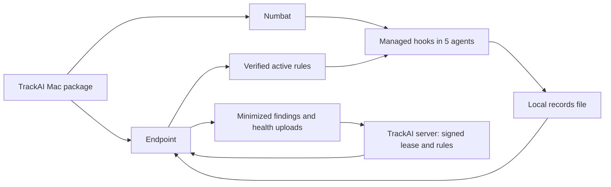

# Task20h-a: what the Mac package does, and how to check it

**Audience:** the founder running the first real Mac check. **Status:** implementation and local tests are complete; the Task20 lead review and the founder's live install are pending. This page is a walkthrough, not a record of a passed live test.

## The idea in one picture



The package puts Numbat at `/Library/Application Support/TrackAI/Endpoint/bin/numbat` and connects its managed hooks to Claude Code, Codex, Cursor, Gemini CLI and Copilot CLI. An agent action writes a preview record to `~/.numbat/records.ndjson`. The Endpoint reads that file and uploads allowed, minimized data when a verified monitoring lease is on. A signed rule bundle can replace the initial placeholder rules.

| Work in this session | What it achieves | How it works |
|---|---|---|
| Package and release build | A Mac receives the Endpoint and the right Numbat binary | Separate Intel (`x64`) and Apple Silicon (`arm64`) packages carry the pinned Numbat build, notices, checksum and trust documents. Install checks Numbat's SHA-256 before adding hooks. |
| Managed agent hooks | Actions from five supported agents reach Numbat | Install registers a managed hook for each agent, with `--emit all --content preview --output file --no-builtin-rules` and an agent-specific rules folder. |
| Safe first start | An empty rule catalogue cannot break an agent | Each folder starts with one enabled rule whose expression is always `false`. It compiles but can never report a finding. `rules/current` points there before the first bundle and when the lease is off or expired. |
| Signed activation and health | Operators can tell what is active | The Endpoint checks the signed lease and bundle, repairs the active rule pointer after expiry or reinstall, and sends hourly security status. The status includes Numbat version, hook wiring, lease, bundle digest, and recent local and server evidence. The agent's own hook view remains a hand check. |
| Offboarding | Remove the managed installation | Root cleanup uninstalls the five hooks, removes the Numbat binary and security state, then runs fleet cleanup. It leaves the user's `~/.numbat` records for separate handling. |

## Founder walkthrough: one disposable Intel Mac account

**When the guest account is needed:** create a fresh standard macOS account before installing the PKG, then **log into that account at the Mac console**. Postinstall chooses the current console user and writes hooks and trust files into that user's home. Creating an account without logging into it does not test this path. Use an Intel Mac for the first run; the package must be `x64`. Keep your everyday account out of this experiment.

1. **Prepare the two inputs.** On the Mac, have an `x64` Task20b Numbat output folder and a local trust directory containing Task20g's matching `root.json`, any `keyset-<scope>.json`, and `dev-pins.json`. Prepare the local TrackAI API, migrated PostgreSQL and Task20f development signer for the same throwaway tenant and machine. The API's development signer uses `SECURITY_POLICY_BUNDLE_CREDENTIAL_ID`, `SECURITY_DEV_POLICY_BUNDLE_KEY_FILE`, `SECURITY_ACTIVATION_LEASE_CREDENTIAL_ID`, and `SECURITY_DEV_ACTIVATION_LEASE_KEY_FILE`; the keys must match the trust documents. The Task20f database verifier is useful separately, but it does **not** start the long-running API for this Mac test. Do not use production keys or a release package for this development-signed test. Install the trust documents before the first Endpoint refresh: a lease refused for missing verification material waits for a new lease, about an hour.

2. **Build the debug package** from this GitAI worktree. Replace the two paths and the version with the actual local inputs. The Numbat output folder's parent must contain `SHA256SUMS`.

   ```sh
   cd /Users/manishmahajan/AIProjects/TrackAI-wt/Task20h-a-endpoint-package-install-gitai
   task build
   packaging/numbat/build.sh darwin amd64 packaging/numbat/out
   packaging/macos/build-pkg.sh \
     --binary target/debug/git-ai \
     --numbat-dir packaging/numbat/out/numbat_v0.2.0-trackai.1_darwin_amd64 \
     --trust-dir /absolute/path/to/dev-trust-documents \
     --arch x64 --version 1.6.19 \
     --output /absolute/path/to/trackai-endpoint-debug-x64.pkg \
     --debug-dev-pins
   ```

3. **Log into the guest account**, then install from a Terminal in that account. The installer prompts for administrator rights. Check the package path before running it.

   ```sh
   sudo installer -pkg /absolute/path/to/trackai-endpoint-debug-x64.pkg -target /
   NUMBAT='/Library/Application Support/TrackAI/Endpoint/bin/numbat'
   "$NUMBAT" --version
   for agent in claude codex cursor gemini copilot; do
     "$NUMBAT" hook status --agent "$agent" --managed
   done
   readlink "$HOME/.git-ai/internal/security/rules/current"
   "$NUMBAT" rules check --no-builtin-rules \
     --rules-dir "$HOME/.git-ai/internal/security/rules/current/copilot"
   ```

   Expect five installed managed hooks and `rules/current` pointing to `placeholder`. For an agent app that is absent from this guest account, hook configuration can still be inspected, but call that agent's live action **untested**, not green. Install each app you intend to prove into the guest account. If a managed Codex `requirements.toml` or Claude Code managed settings already exist, record that they stay intact after install and offboarding.

4. **Before publishing a bundle, test real agent actions in this order:** open Copilot CLI and run a harmless action, then do the same in Claude Code. Confirm each action runs, its hook exits successfully, new lines appear in `~/.numbat/records.ndjson`, and no finding appears. The earlier synthetic hook calls established the command behavior; these real app actions establish the installation behavior. Copilot goes first because its CLI can deny an action after a hook crash.

5. **Turn monitoring on in the local TrackAI admin settings.** Publish the development-signed rule bundle for the throwaway machine. Check that the Endpoint reports the new bundle digest and an `applied` acknowledgement; trigger a harmless command chosen to match one enabled rule and find its minimized finding in TrackAI. Then switch monitoring off. Confirm `rules/current` returns to `placeholder`, uploads stop, and a new harmless action can still append a **local** preview record. Off means no upload; it does not erase or stop local recording. After the rule trigger, "green" means `hook_status`, `local_record`, and `forwarder_ack` are `ok`. Check the effective hook view by hand: Claude Code `/hooks`, Cursor Customize > Hooks, and Gemini CLI `/hooks`; Codex and Copilot CLI have no readable view. Record each result. The Endpoint reports `agent_effective_view` as `unavailable` in this phase.

6. **Measure latency once** on this Mac using the pinned Numbat measurement script, and record median and p95 for the hook and both hooks together. The final budget in `TASK20.md` §6 is still to be set, so record measurements without calling them a budget pass.

7. **Offboard after collecting evidence.** Run this from an administrator account, naming the disposable guest account. Read the dry run first. The apply step removes that account's managed hooks and security state, plus the machine-wide Numbat installation; do not run it while another account needs this test installation.

   ```sh
   cd /Users/manishmahajan/AIProjects/TrackAI-wt/Task20h-a-endpoint-package-install-gitai
   GUEST='replace-with-disposable-short-name'
   sudo mdm/macos/cleanup-endpoint.sh --dry-run --user "$GUEST"
   sudo mdm/macos/cleanup-endpoint.sh --apply --user "$GUEST"
   test ! -e '/Library/Application Support/TrackAI/Endpoint/bin/numbat'
   sudo -H -u "$GUEST" sh -c 'test ! -e "$HOME/.git-ai/internal/security"'
   ```

   Check the five hook statuses are no longer installed and the guest account's `~/.git-ai/internal/security` is gone. The guest's `~/.numbat` is intentionally preserved; delete it separately only when its local records are no longer needed.

## What this proves, and what remains

| After this check passes | Still needs its own evidence |
|---|---|
| A real Intel Mac console install can wire the tested agents, start safely on placeholder rules, apply a development-signed bundle, upload a finding, stop uploading when off, and clean up. | A second Mac and Apple Silicon install; any claim about multiple machines. |
| Local status and server acknowledgement can be compared with actual records. | Five **live** agent actions if some apps were absent from the guest account; the separate Task20h-b inventory and day-one scan. |
| The package and cleanup path can be observed on one disposable account. | Task9's paused package, offline queue, update, rollback, credential rotation, revocation and Jamf checks. In particular, this first install is **not** a rollback test. |
| Development trust documents can exercise the signed path locally. | Task15n production trust pins and keys; release workflow execution with the `release` environment trust-document secret; package signing/notarization where Task14 applies; Windows and Linux support. |

The release secret `TRACKAI_SECURITY_TRUST_DOCUMENTS_B64` must hold a base64 gzip tar of flat `root.json` and optional `keyset-<scope>.json` files. Configure it only when the production trust documents exist. The release package never contains `dev-pins.json`, and the current release verifier has no production root pin, so a release build stays off until Task15n. Keep the live results in the Task20/Task9 trackers after the founder run; this guide does not mark those gates complete.
